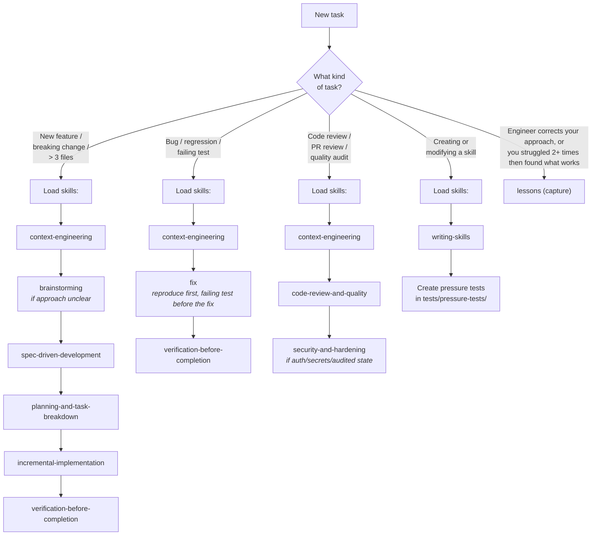
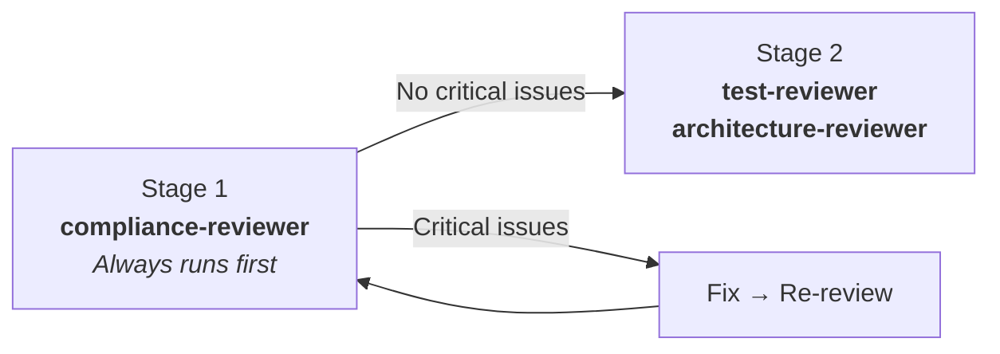

# MTK Agent Routing Guide

The compact routing tables live in `AGENTS.md` (the canonical constitution). This guide holds
the detail: the full decision tree, the composition of every routed workflow, the skills the
model loads on its own, and the mechanics behind review output, evals, and reference loading.

Read this when you need to know *how* a workflow composes. For "which command do I run", the
tables in `AGENTS.md` are enough.

---

## Routing Decision Tree

---

## Routed Workflow Skills

Reached via `/mtk <description>`; `mtk-doctor` and `lessons` are also directly invocable.

| Workflow | Composition |
|:---|:---|
| fix | reproduce → failing test → root-cause fix within 1–3 files → focused verification |
| batch-fix | corrective batch of multiple small independent fixes (>3 files, no new contract) → findings list + spec stub + one gate → per-finding TDD → inline impl → proportional review; between `fix` and `implement` |
| implement | brainstorm *(optional)* → context → spec *(+ JSON sidecar)* → task breakdown → test-first batches → **spec-drift-detection** → two-stage review → simplification |
| pre-commit-review | static linter pass *(confidence 100)* → AI review *(confidence-scored)*, merged via `.claude/references/review-finding-schema.md` |
| setup-refresh | drift-scoped refresh of all generated setup artifacts (reached via `/mtk-setup --refresh`) — staleness plan → scoped regen → diff proposals for engineer-edited files; `--check` is the read-only drift report of code against the agreed principles |
| repo-health | 9-asset AI-readiness action checklist (no score) → audit drift → PR review mining (last N merged PRs, suggest-only `[MINED:feedback]`) |
| mtk-doctor | install health check across core files, components, hooks, integrity, active config — PASS/WARN/FAIL, `--json`, `--fix`; `--usage` prints raw usage counts with n |
| research-context | cited external research brief (library best-practices, version-specific behavior) grounded in named project files |
| instructions | constitution `audit` (verify-references / verify-commands → append-only diffs) or session `capture` (new commands/gotchas), applied only with approval |
| lessons | team lessons lifecycle, also user-invocable as `/lessons <mode>`: `capture` (a correction or golden path), `mine` (reject-by-default transcript sweep, suggest-only), `refresh` (Keep/Update/Consolidate/Retire stale anchors, suggest-only), `promote` (native memory → `tasks/lessons.md`, optional contribute-back PR; `/promote-lesson` is a one-release alias) |

---

## Model-Invoked Skills

Not user-invocable — loaded automatically when triggered:

- `handoff` — capture session state when context is tight or work is paused mid-stream
- `lessons` (`capture` mode) — capture an engineer correction, or a working approach found after struggling 2+ times with the same sub-problem, as a reusable lesson
- `prior-work-check` — before approving a spec or multi-file work, confirm no existing skill/helper/handler/lesson already covers it
- `subagent-implementation` — replaces incremental-implementation for 3+ batches, 6+ non-mechanical files, or non-none security_impact; one fresh implementer subagent per batch
- `code-simplification` — after a verified fix/feature, run Claude Code's `/simplify` with the finance and security carve-outs
- `workflow-artifacts` — durable workflow state under `.mtk/workflows/` so orchestration survives compaction, crash, and handoff

---

## Review Routing (Two-Stage)

**Stage 1 (spec compliance):** Always runs first.
- Security/compliance-sensitive work → `compliance-reviewer`

**Stage 2 (quality and coverage):** Only after Stage 1 passes with no Critical issues.
- Test completeness or missing coverage → `test-reviewer`
- Architecture or slice boundary concerns → `architecture-reviewer`
- Error-handling diff (catch/except/`?.`/`??`/eslint-disable/Skip) → `silent-failure-hunter` (runs in parallel with `compliance-reviewer` in Stage 1 when triggered)

---

## Review Output Schema (v5.5+)

All review entry points emit a markdown table plus a fenced JSON block per
`.claude/references/review-finding-schema.md`. Findings carry
`source: "linter" | "ai" | "drift"`, a severity, and a confidence (0–100).
Default threshold 80 (configured in `.claude/review-config.json`; override
via a local review-config override file, which is gitignored).

## Eval Pipeline

Behavioural evals live under `evals/` as native `claude plugin eval` cases
(prompt + scaffold script + hidden graders), covering verification evidence,
pre-commit secrets, force-push, silent failures, fix-scope escalation, `/mtk`
routing and implement approval. The `core` tag gates every release
(`.github/workflows/release.yml`); `evals/README.md` has the run commands and
the three-arm comparison method.

## Tech Stack Loading

The toolkit uses pluggable tech stacks. The active stack is recorded in `.claude/tech-stack` (a
single word like `dotnet`, `python`, or `typescript`). Every entry-point skill and agent reads
this file in Phase 0 and loads the matching `tech-stack-{stack}` skill, which provides build and
test commands, ORM and framework patterns, stack-specific reference paths, scan recipes for
`setup-bootstrap` and `setup-audit`, and settings to merge during setup. For the `typescript`
stack, `.claude/tech-stack-pm` additionally stores the auto-detected package manager (bun /
pnpm / yarn / npm). If a repo has no `.claude/tech-stack` file, run `/mtk-setup` first.

## Progressive Reference Loading

Load shared references **progressively** — only what the current phase needs:

| Phase | References |
|:---|:---|
| **Always** | The coding guidelines from the active tech stack's `## Reference Files` |
| **Planning** | `domain-finance.md` *(if scope touches money, audit or auth)*, the stack's testing supplement |
| **Implementation** | the stack's data-layer and analyzer references from its `## Reference Files` |
| **Review** | the repo's quick-check list *(if present)* |

## Path-Scoped Reference Loading

Reference entries in `.claude/manifest.json` may declare an `applyTo`
glob array. `context-engineering` matches touched files against these
globs and loads only the matching references, avoiding session-wide
context bloat.
